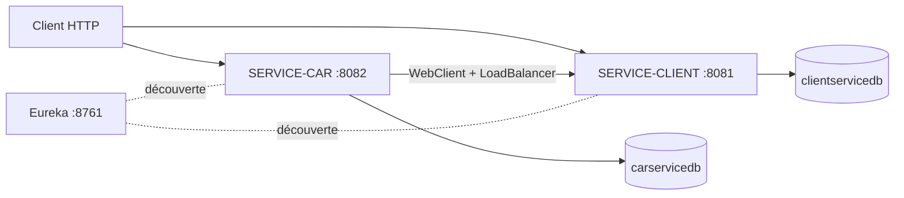

# TP21 — Microservices avec WebClient

Implémentation du [TP21 du cours Architecture Microservices](https://mliaedu.toubkalit.com/student/courses/7/labs/261). Le projet contient trois modules Maven : Eureka Server, service Client et service Voiture.



## Prérequis et compilation

- JDK 17 ou plus, Maven 3.9 ou plus.
- Ports libres : 8761, 8081 et 8082.
- MySQL pour la configuration par défaut. `DB_USER` et `DB_PASSWORD` permettent de fournir les identifiants. L'utilisateur doit pouvoir créer les bases indiquées dans les URL JDBC.

```powershell
mvn -B -ntp clean verify
```

Le profil `demo` sélectionne H2 en mémoire. Après compilation, ouvrir trois terminaux à la racine du projet et lancer :

```powershell
java -jar eureka-server/target/eureka-server-1.0-SNAPSHOT.jar
java -jar service-client/target/service-client-1.0-SNAPSHOT.jar --spring.profiles.active=demo
java -jar service-car/target/service-car-1.0-SNAPSHOT.jar --spring.profiles.active=demo
```

Sans le profil `demo`, les services utilisent MySQL. Vérifier sur <http://localhost:8761/> que `SERVICE-CLIENT` et `SERVICE-CAR` sont enregistrés.

## Scénario demandé

```powershell
$client = Invoke-RestMethod -Method Post -Uri http://localhost:8081/api/clients -ContentType application/json -Body '{"nom":"Salma","age":22}'
$body = @{ marque='Toyota'; modele='Yaris'; clientId=$client.id } | ConvertTo-Json
Invoke-RestMethod -Method Post -Uri http://localhost:8082/api/cars -ContentType application/json -Body $body
Invoke-RestMethod "http://localhost:8082/api/cars/byClient/$($client.id)"
```

Le service Voiture expose aussi `GET /api/cars` et l'endpoint pédagogique `GET /api/test/client/{id}`. Son `WebClient.Builder` porte `@LoadBalanced` et appelle `http://SERVICE-CLIENT/api/clients/{id}` via Eureka. Le `block()` sert ici à intégrer l'appel dans un contrôleur MVC synchrone, comme dans le TP.

Le scénario automatisé démarre les trois services, crée un client et une voiture, valide l'enrichissement et arrête uniquement les processus lancés :

```powershell
./scripts/smoke-test.ps1
```

Ses journaux sont sous `target/smoke-test/`. Chaque service ne conserve que ses propres données ; `clientId` est la référence entre services et `client` est un champ `@Transient` pour la réponse JSON.

## Résultat vérifié

Le 17 novembre 2026, `mvn -o -B -ntp verify` a réussi et les tests des deux services ont passé. Le script a renvoyé :

```json
{"id":1,"marque":"Toyota","modele":"Yaris","clientId":1,"client":{"id":1,"nom":"Salma","age":22.0}}
```
